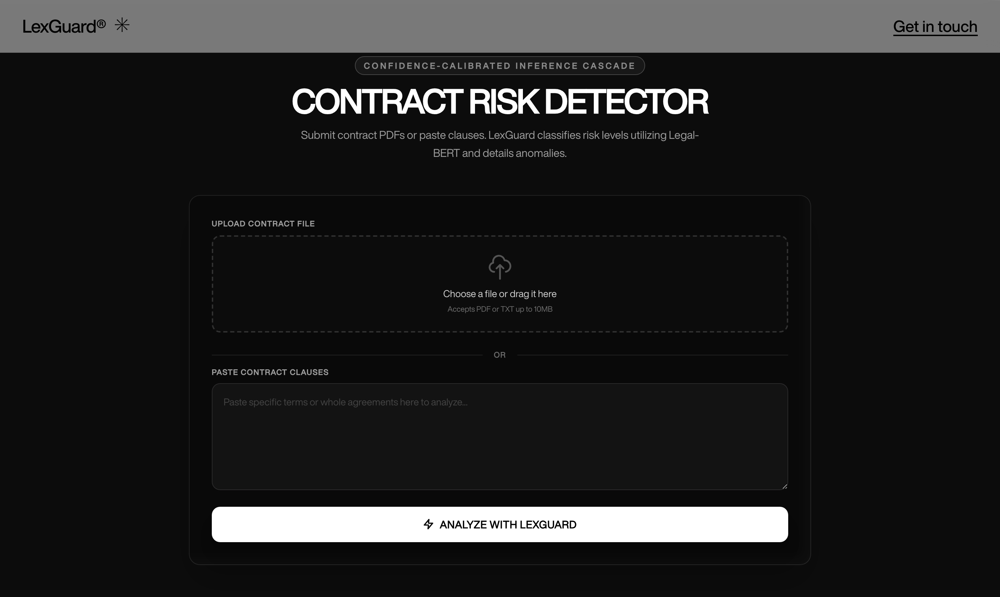

# LexGuard — Legal Contract Risk Detector

[](https://github.com/HEMANTH-A-7/Legal-Risk-Detector/actions/workflows/tests.yml)
[](https://huggingface.co/spaces/Hemanth021/legal-risk-detector)
[](LICENSE)

Upload a contract (PDF or text) and LexGuard flags risky clauses — liability, penalty, termination, obligation, arbitration — with a severity score and a plain-English explanation.

**[Try the live demo →](https://huggingface.co/spaces/Hemanth021/legal-risk-detector)** (free tier — the first request after idle can take a minute while the model loads)



Accepted at **ICDCIT 2027** (23rd International Conference on Distributed Computing and Intelligent Technology).

**Stack:** Python · Flask · PyTorch / Hugging Face Transformers · scikit-learn · React + TypeScript (Vite) · Docker · Hugging Face Spaces

---

## How it works

Each sentence goes through a three-tier cascade. A tier answers only if it is confident enough; otherwise the sentence falls through to the next, cheaper tier.

```
contract (PDF / text)
        │  pdfplumber + NLTK sentence segmentation
        ▼
┌──────────────────────────────────────────────────────────────┐
│ Tier 1  Legal-BERT (fine-tuned)                               │
│         raw softmax p → calibrated = sigmoid(logit(p) / T)    │
│         calibrated ≥ τ_t (0.60)?  yes → done                  │
├──────────────────────────────────────────────────────────────┤
│ Tier 2  TF-IDF + Logistic Regression                          │
│         p ≥ τ_m (0.50)?           yes → done                  │
├──────────────────────────────────────────────────────────────┤
│ Tier 3  Keyword rules (deterministic)                         │
└──────────────────────────────────────────────────────────────┘
        ▼
Severity estimator → High / Medium / Low → JSON → React dashboard
```

Severity combines four signals: modal-verb strength (*must* > *shall* > *may*), amplifier/suppressor phrases (*unlimited*, *irrevocably* vs *not required*), a per-category base weight, and the calibrated Tier 1 confidence when available.

## Engineering decisions

**Why a cascade instead of one model.** A single classifier either answers wrongly or not at all when it is unsure. The cascade accepts the transformer's label only when its calibrated confidence clears a threshold, and otherwise hands the sentence to an independent model and then to deterministic rules, so every sentence gets a decision and each response records which tier made it (`detector`). In the paper's evaluation, 97% of clauses were resolved at Tier 1.

**Why calibrate before thresholding.** Fine-tuned BERT models are over-confident, so a raw 0.95 is not a trustworthy "95% sure". Temperature scaling (Guo et al., 2017) corrects this before the threshold check, so an over-confident wrong label doesn't block the fallback tiers. In the paper, temperature scaling cut Expected Calibration Error by 48% (0.034 → 0.018).

**Graceful degradation.** If the transformer weights fail to load, the cascade continues on Tier 2; if the TF-IDF model is missing, it continues on keywords. The `/explain` endpoint uses an LLM only when `OPENAI_API_KEY` is set and otherwise returns a template explanation. These paths are covered by tests.

**Operational limits.** Uploads are limited to PDF/TXT and 10 MB (configurable). Errors are logged server-side and returned to clients as generic messages. The container runs one Gunicorn worker because each worker loads its own copy of the model (~830 MB RSS).

**Everything is configurable at runtime.** Tier selection, both thresholds and the temperature are environment variables, so the cascade can be tuned or run as a single tier (for ablations) without code changes.

## Results

| | Value | Source |
|---|---|---|
| Six-class Macro-F1 (cascade) | 92.24% | ICDCIT 2027 paper |
| Training corpus | 23,525 samples (CUAD + LEDGAR) | ICDCIT 2027 paper |
| Fitted temperature | T = 1.144 | ICDCIT 2027 paper |
| ECE before → after calibration | 0.034 → 0.018 | ICDCIT 2027 paper |
| Clauses resolved at Tier 1 | 97% | ICDCIT 2027 paper |
| Transformer inference time | 43.7 s → 7.4 s | ICDCIT 2027 paper |
| Shipped Legal-BERT checkpoint, held-out Macro-F1 | 95.33% | [`training_meta.json`](models/transformer_risk_classifier/training_meta.json) |

The code has changed since the paper was submitted (for example, the default `CCIC_TEMPERATURE` is 1.5 rather than the fitted 1.144), so the paper's numbers describe the experimental setup, not necessarily the current defaults.

## Run locally

```bash
git lfs install && git clone https://github.com/HEMANTH-A-7/Legal-Risk-Detector
cd Legal-Risk-Detector
pip install -r requirements.txt
cp .env.example .env          # optional: set OPENAI_API_KEY for LLM explanations
python download_nltk.py
python app.py                 # http://localhost:8000
```

Or with Docker:

```bash
docker build -t lexguard . && docker run -p 8000:8000 lexguard
```

## Tests

```bash
pip install pytest
pytest -q
```

The suite (46 tests) covers calibration math, severity scoring, every cascade routing path including tier failures, and the HTTP API (validation, upload limits, error handling, LLM fallback). Tier 1 is stubbed, so tests run in a few seconds without torch or model weights. CI runs them on every push.

## API

### `POST /analyze`

`multipart/form-data` with either `file` (PDF/TXT) or `text`.

```json
{
  "risks": [
    {
      "original_sentence": "The party shall indemnify and hold harmless...",
      "risk_type": "Liability",
      "severity": "High",
      "severity_score": 0.7821,
      "confidence": 0.9124,
      "detector": "transformer",
      "explanation": "...",
      "explanation_source": "template"
    }
  ],
  "ccic": {
    "mode": "auto",
    "temperature": 1.5,
    "transformer_threshold": 0.6,
    "ml_threshold": 0.5,
    "detector_distribution": { "transformer": 30, "ml": 5, "keyword": 3 }
  },
  "summary": {
    "total_sentences": 53,
    "risky_count": 38,
    "risk_percentage": 71.7,
    "severity_distribution": { "High": 12, "Medium": 20, "Low": 6 }
  }
}
```

`400` for a missing input or unsupported file type, `413` for an upload over the size limit.

### `POST /explain`

JSON body `{ "sentence": "...", "risk_type": "Liability", "severity": "High" }`. Returns `{ "explanation": "...", "source": "llm" | "template" }`.

## Configuration

| Variable | Default | Description |
|---|---|---|
| `RISK_DETECTOR` | `auto` | `auto` (full cascade), or a single tier: `transformer`, `ml`, `keyword` |
| `TRANSFORMER_THRESHOLD` | `0.60` | Tier 1 threshold τ_t (on calibrated confidence) |
| `ML_RISK_THRESHOLD` | `0.50` | Tier 2 threshold τ_m |
| `CCIC_TEMPERATURE` | `1.5` | Temperature T for calibration |
| `TRANSFORMER_MODEL_DIR` | `models/transformer_risk_classifier` | Fine-tuned model directory |
| `RISK_MODEL_PATH` | `models/risk_classifier.joblib` | TF-IDF + LogReg model |
| `OPENAI_API_KEY` | *(unset)* | Enables LLM explanations on `/explain` |
| `OPENAI_MODEL` | `gpt-4o-mini` | Model used for explanations |
| `OPENAI_BASE_URL` | *(unset)* | Point at any OpenAI-compatible provider |
| `MAX_UPLOAD_BYTES` | `10485760` | Upload size limit (10 MB) |
| `FLASK_DEBUG` | `0` | Set to `1` for the Flask debugger (local only) |

## Training

```bash
pip install -r requirements-dev.txt

# Build the merged corpus from CUAD + LEDGAR
python scripts/map_cuad.py --dataset both
python scripts/map_cuad.py --merge --output data/training_merged.csv

# Tier 2: TF-IDF + Logistic Regression
python train_model.py --mode ml --data data/training_merged.csv

# Tier 1: fine-tune Legal-BERT (GPU with 6 GB+ VRAM, e.g. a Colab T4)
python train_model.py --mode transformer --model legal-bert \
    --data data/training_merged.csv --epochs 3 --batch_size 16
```

`data/training_merged.csv` in the repo is a 4,919-sentence subset; the scripts above rebuild the full corpus.

## Project layout

```
app.py                 Flask app: /analyze, /explain, serves the built frontend
utils/
  nlp_utils.py         Cascade orchestration, keyword tier, PDF/sentence handling
  transformer_classifier.py   Tier 1 inference
  ml_classifier.py     Tier 2 inference
  calibration.py       Temperature scaling and ECE
  severity_estimator.py       Severity scoring
  llm_explainer.py     Optional LLM explanations
frontend/              React + TypeScript source (built into static/dist)
scripts/               Dataset download and preprocessing
train_model.py         Training entry point for both tiers
tests/                 pytest suite
```

## Known limitations

- The cascade assigns one label per sentence; a clause carrying two risks reports the first.
- Clause boundaries come from sentence segmentation, so long multi-sentence clauses are split.
- The keyword tier is intentionally broad (e.g. any *shall* counts as an obligation) and is a last resort, not a classifier.
- This is a research prototype, not legal advice.

## Citation

```bibtex
@inproceedings{lexguard2027,
  title     = {LexGuard: Automated Legal Risk Detection and Severity Estimation in
               Contracts Using NLP-Driven Confidence-Calibrated Inference Cascades},
  author    = {Amarthi, Hemanth Kumar and M, Dhanesh Sai and K, Purushottama Rao},
  booktitle = {Proceedings of the 23rd International Conference on Distributed
               Computing and Intelligent Technology (ICDCIT 2027)},
  series    = {Lecture Notes in Computer Science},
  publisher = {Springer},
  year      = {2027}
}
```

## References

1. Guo et al. (2017). *On Calibration of Modern Neural Networks*. ICML.
2. Chalkidis et al. (2020). *LEGAL-BERT: The Muppets straight out of Law School*. Findings of EMNLP.
3. Hendrycks et al. (2021). *CUAD: An Expert-Annotated NLP Dataset for Legal Contract Review*. NeurIPS.
4. Tuggener et al. (2020). *LEDGAR: A Large-Scale Multi-label Corpus for Text Classification of Legal Provisions*. LREC.

## License

[MIT](LICENSE) © Amarthi Hemanth Kumar
